# FINZAVE FRONTEND DESIGN ANALYSIS & SPECIFICATION
## Comprehensive Reverse-Engineered Design System, Interaction Model, and Implementation Guide

**Document Version:** 1.0.0  
**Status:** Authoritative Forensic Extraction  
**Date of Extraction:** October 17, 2026  
**Auditor / Specialist:** Senior Frontend Reverse Engineer, Design Systems Architect & Motion Specialist  
**Target Project:** FinZave (Personal Finance Web Application)  
**Deliverable Path:** `FINZAVE_FRONTEND_DESIGN_ANALYSIS.md`  

---

## TABLE OF CONTENTS

1. [Executive Summary](#1-executive-summary)
2. [Inspection Scope and Methodology](#2-inspection-scope-and-methodology)
3. [Public Route Inventory & Surface Boundary](#3-public-route-inventory--surface-boundary)
4. [Architecture and Component Hierarchy](#4-architecture-and-component-hierarchy)
5. [Global Design System Tokens](#5-global-design-system-tokens)
6. [Typography and Font System](#6-typography-and-font-system)
7. [Color, Shades, and Visual Tokens](#7-color-shades-and-visual-tokens)
8. [Layout, Spacing, and Grid Reference](#8-layout-spacing-and-grid-reference)
9. [Page-by-Page Visual Reverse Engineering](#9-page-by-page-visual-reverse-engineering)
   - 9.1 Home Page (`/`)
   - 9.2 About Us (`/about`)
   - 9.3 Services / Core Platform (`/services`)
   - 9.4 Workflow Architecture (`/workflow`)
   - 9.5 User Reviews (`/reviews`)
   - 9.6 Frequently Asked Questions (`/faq`)
   - 9.7 Terms & Policies (`/terms`)
   - 9.8 Privacy Policy (`/privacy`)
   - 9.9 Authentication Pages (`/login` & `/signup`)
   - 9.10 Error Pages (`404`, `403`, `500`)
10. [Hero Section Forensic Breakdown](#10-hero-section-forensic-breakdown)
11. [Navigation and Header Specifications](#11-navigation-and-header-specifications)
12. [Section, Card, and Partition Patterns](#12-section-card-and-partition-patterns)
13. [Animation and Motion Analysis](#13-animation-and-motion-analysis)
14. [Buttons, Forms, and Interactive Controls](#14-buttons-forms-and-interactive-controls)
15. [Images, Icons, and Visual Assets](#15-images-icons-and-visual-assets)
16. [Footer — Complete Breakdown](#16-footer--complete-breakdown)
17. [Responsive Design & Breakpoint Matrix](#17-responsive-design--breakpoint-matrix)
18. [Reusable Design System Specification](#18-reusable-design-system-specification)
19. [Triads Future Transfer Guide](#19-triads-future-transfer-guide)
20. [Source Traceability and Verification Evidence](#20-source-traceability-and-verification-evidence)

---

## 1. EXECUTIVE SUMMARY

The FinZave frontend represents an editorial, Swiss-modernist aesthetic applied to modern personal finance. Rather than relying on cartoonish illustrations, skeuomorphic graphs, or dense dashboard clutter on its public-facing pages, FinZave employs a high-contrast monochrome foundation (**Obsidian Black** `#0a0a0a` and **Pure White** `#ffffff`) punctuated by an intentional **Crimson Red accent** (`#e11d48` / `rgb(225, 29, 72)`).

### Core Aesthetic Hallmarks:
1. **Dramatic Editorial Typography:** Dominated by Google Font **Outfit** (weights 300 to 700), featuring ultra-tight tracking (`tracking-tighter` / `-0.05em`), condensed line-heights (`leading-[0.95]`), and oversized display scale (`text-6xl md:text-8xl lg:text-[7rem]`).
2. **Minimalist Structural Framing:** Thin 1px Zinc borders (`#e4e4e7` and `#f4f4f5`) frame spacious content blocks, utilizing numbered step indicators (e.g., `01`, `02`, `03`) that transition in color from neutral black to vivid red as the user scrolls.
3. **Glassmorphism & Ambient Glow:** Backdrops feature subtle blurred gradient radial glows (`blur-[100px]`, `blur-[120px]`) and translucent frosted navigation bars (`glass-panel` with `backdrop-filter: blur(16px)`).
4. **Deterministic Motion Choreography:** Staggered word-by-word headline reveals (80ms intervals), sequential workflow pipeline transitions, and viewport-driven scroll spies orchestrated using native browser `IntersectionObserver` with zero external heavy animation libraries (e.g., no GSAP or Framer Motion overhead).
5. **Full Accessibility Grace:** Complete fallback mechanisms for `prefers-reduced-motion: reduce`, ensuring all content, transitions, and transforms render instantaneously and statically for users with vestibular sensitivities.

This document serves as the exhaustive visual and technical blueprint for recreating this design language faithfully in any target web application.

---

## 2. INSPECTION SCOPE AND METHODOLOGY

### 2.1 Technical Environment
- **Framework:** Flask 3.1.3 (Python 3.9+) with Jinja2 Templating
- **Styling Architecture:** Tailwind CSS v3.4.17 (Static Build via `tailwindcss-v3.exe` compiling `static/css/input.css` into `static/css/output.css`)
- **Iconography:** Lucide Icons (Web component SVG via CDN script)
- **Typography:** Google Fonts (`family=Outfit:wght@300;400;500;600;700`)
- **Interactive Logic:** Native Vanilla JavaScript (DOM APIs, `IntersectionObserver`, `fetch`)

### 2.2 Verification Methodology
Every finding documented herein has been validated through a dual-channel forensic process:
1. **Source Code Static Analysis:** Direct inspection of Jinja2 templates (`templates/base_public.html`, `templates/public/*.html`, `templates/auth/*.html`), stylesheets (`static/css/input.css`, `output.css`, `style.css`), route controllers (`routes/public.py`, `routes/auth.py`), and commit history (`git log -p tailwind.config.js`).
2. **Visual & Interactive Runtime Audit:** The local development server was initiated on `http://127.0.0.1:5050` connected to PostgreSQL. An autonomous browser subagent rendered and inspected public pages across three standard viewport dimensions:
   - **Wide Desktop:** 1440 × 900 px
   - **Tablet Viewport:** 768 × 1024 px
   - **Narrow Mobile:** 375 × 812 px

All interaction states—including mobile hamburger drawer deployment, FAQ accordion expand/collapse, password visibility hover/click triggers, and scroll-linked color transitions—were visually executed and recorded as WebP video artifacts.

---

## 3. PUBLIC ROUTE INVENTORY & SURFACE BOUNDARY

The application establishes a clear architectural perimeter dividing unauthenticated marketing/public surfaces from authenticated application tools and internal administrative dashboards.

### 3.1 Public Surface Inventory

| Route | View Controller | Template Source | Authentication | Layout Base |
| :--- | :--- | :--- | :--- | :--- |
| `/` | `routes/public.py::home` | `templates/public/home.html` | Public (Unrestricted) | `templates/base_public.html` |
| `/about` | `routes/public.py::about` | `templates/public/about.html` | Public (Unrestricted) | `templates/base_public.html` |
| `/services` | `routes/public.py::services` | `templates/public/services.html` | Public (Unrestricted) | `templates/base_public.html` |
| `/workflow` | `routes/public.py::workflow` | `templates/public/workflow.html` | Public (Unrestricted) | `templates/base_public.html` |
| `/reviews` | `routes/public.py::reviews` | `templates/public/reviews.html` | Public (Unrestricted) | `templates/base_public.html` |
| `/faq` | `routes/public.py::faq` | `templates/public/faq.html` | Public (Unrestricted) | `templates/base_public.html` |
| `/terms` | `routes/public.py::terms` | `templates/public/terms.html` | Public (Unrestricted) | `templates/base_public.html` |
| `/privacy` | `routes/public.py::privacy` | `templates/public/privacy.html` | Public (Unrestricted) | `templates/base_public.html` |
| `/login` | `routes/public.py::login` | `templates/auth/login.html` | Public / Entry Point | `templates/base_public.html` |
| `/signup` | `routes/public.py::signup` | `templates/auth/signup.html` | Public / Entry Point | `templates/base_public.html` |
| `HTTP 404` | `app.py::page_not_found` | `templates/404.html` | Public Error | `templates/base_public.html` |
| `HTTP 403` | Explicit error template | `templates/403.html` | Public / Access Guard | `templates/base_public.html` |
| `HTTP 500` | `app.py::internal_server_error` | `templates/errors/500.html` | Server Error | `templates/base_public.html` |

### 3.2 Authenticated Boundary (Excluded from Public Marketing Reference)
The following routes belong strictly to the authenticated app (`routes/user.py` / `templates/app/` with prefix `/app`) and the admin console (`routes/admin.py` / `templates/admin/` with prefix `/admin`):
- `/app/dashboard`, `/app/transactions`, `/app/goals`, `/app/analysis`, `/app/planning`, `/app/reports`, `/app/profile`, `/app/feedback`
- `/admin/dashboard`, `/admin/users`, `/admin/reviews`, `/admin/feedback`

These authenticated screens utilize distinct inner app shells (`base_app.html`, `base_admin.html`) with sidebar layouts, table controls, and dynamic charts that are outside the scope of the public marketing presentation.

---

## 4. ARCHITECTURE AND COMPONENT HIERARCHY

```mermaid
graph TD
    subgraph Shared Public Shell [base_public.html]
        NAV[Sticky Navigation Header<br/>h-72px, glass-panel, z-50]
        MAIN[Main Content Container<br/>flex-grow]
        FOOT[Public Footer<br/>bg-fz-black, pt-16 pb-8]
        MOB[Mobile Drawer Menu<br/>absolute w-full, hidden lg:hidden]
    end

    subgraph Public Page Components
        HOME[home.html<br/>Editorial Hero + Problem + Formula + Numbers + Compare + Wireframe + CTA]
        ABOUT[about.html<br/>Asymmetric Hero + Problem + Purpose/Goal + Numbers + Timeline + Principles]
        SERVICES[services.html<br/>Scroll Hero + Analysis Engine + SVG Goal Progress + Split Calculators + Matrix]
        WORKFLOW[workflow.html<br/>Ribbon Hero + Vertical Stepper + Black Pill Data Flow + Rule Box + Loop]
        REVIEWS[reviews.html<br/>Centered Header + 3-Col Review Cards + Pagination]
        FAQ[faq.html<br/>Centered Hero + Native details/summary Accordion by Category]
        LEGAL[terms.html & privacy.html<br/>Centered Hero + Editorial Prose Document with Red Rule Dividers]
        AUTH[login.html & signup.html<br/>Centered Auth Card + Floating Helper Rules + Live Form Validation]
    end

    NAV --> MOB
    MAIN --> HOME
    MAIN --> ABOUT
    MAIN --> SERVICES
    MAIN --> WORKFLOW
    MAIN --> REVIEWS
    MAIN --> FAQ
    MAIN --> LEGAL
    MAIN --> AUTH
```



---

## 5. GLOBAL DESIGN SYSTEM TOKENS

The design system is extracted directly from the compiled Tailwind token declarations discovered in git commit history (`tailwind.config.js`) and cross-checked against CSS selectors in `static/css/input.css` and `static/css/output.css`.

### 5.1 Color Palette Table

| Token Identifier | Class Prefix | Hex Value | RGB Channels | HSL Representation | Design Intent & Usage |
| :--- | :--- | :--- | :--- | :--- | :--- |
| `fz-black` | `bg-fz-black`<br/>`text-fz-black`<br/>`border-fz-black` | `#0a0a0a` | `rgb(10, 10, 10)` | `hsl(0, 0%, 4%)` | Primary brand background (dark sections, footer, primary buttons, hero text). |
| `fz-white` | `bg-fz-white`<br/>`text-white`<br/>`border-white` | `#ffffff` | `rgb(255, 255, 255)` | `hsl(0, 0%, 100%)` | Canvas background, light cards, primary button text in dark mode. |
| `fz-red` | `bg-fz-red`<br/>`text-fz-red`<br/>`border-fz-red` | `#e11d48` | `rgb(225, 29, 72)` | `hsl(346, 77%, 50%)` | Accent color (active numbers, warning pill, highlights, hover states, selection). |
| `fz-red-hover` | `hover:bg-fz-red` | `#be123c` | `rgb(190, 18, 60)` | `hsl(346, 83%, 41%)` | Darkened hover state for interactive red elements and buttons. |
| `fz-gray-100` | `bg-fz-gray-100`<br/>`border-fz-gray-100` | `#f4f4f5` | `rgb(244, 244, 245)` | `hsl(240, 5%, 96%)` | Subtle card background, badge backgrounds, inner borders (Zinc-100). |
| `fz-gray-200` | `border-fz-gray-200`<br/>`bg-fz-gray-200` | `#e4e4e7` | `rgb(228, 228, 231)` | `hsl(240, 6%, 90%)` | Standard container border, hairline separators, timeline lines (Zinc-200). |
| `fz-gray-300` | `text-fz-gray-300`<br/>`border-fz-gray-300` | `#d4d4d8` | `rgb(212, 212, 216)` | `hsl(240, 5%, 84%)` | Secondary headline text ("Don't just track it"), inactive steps (Zinc-300). |
| `fz-gray-400` | `text-fz-gray-400` | `#a1a1aa` | `rgb(161, 161, 170)` | `hsl(240, 5%, 65%)` | Subtitles in dark sections, footer link text, helper metadata (Zinc-400). |
| `fz-gray-500` | `text-fz-gray-500` | `#71717a` | `rgb(113, 113, 122)` | `hsl(240, 4%, 46%)` | Footer legal text, subtle subheadings (Zinc-500). |
| `fz-gray-600` | `text-fz-gray-600` | `#52525b` | `rgb(82, 82, 91)` | `hsl(240, 5%, 34%)` | Body copy in feature lists, descriptions on light background (Zinc-600). |
| `fz-gray-700` | `text-fz-gray-700` | `#3f3f46` | `rgb(63, 63, 70)` | `hsl(240, 5%, 26%)` | Inactive large numbers (`01-04`) on dark background, editorial body (Zinc-700). |
| `fz-gray-800` | `text-fz-gray-800`<br/>`bg-fz-gray-800`<br/>`border-fz-gray-800` | `#27272a` | `rgb(39, 39, 42)` | `hsl(240, 4%, 13%)` | Navigation links, dark section border dividers, secondary body copy (Zinc-800). |
| `fz-gray-900` | `bg-fz-gray-900`<br/>`border-fz-gray-900` | `#18181b` | `rgb(24, 24, 27)` | `hsl(240, 6%, 10%)` | Dark card backgrounds, elevated panels in dark sections (Zinc-900). |
| `fz-gray-50` | `bg-fz-gray-50` | `#fafafa` | `rgb(250, 250, 250)` | `hsl(0, 0%, 98%)` | Alternating section backgrounds, form container inputs (Zinc-50). |

---

## 6. TYPOGRAPHY AND FONT SYSTEM

FinZave utilizes Google Fonts' **Outfit** family across all public pages, paired with system monospaced stacks for mathematical representations and financial formulas.

### 6.1 Font Stack Declarations
- **Primary Geometric Sans-Serif:**
  ```css
  font-family: 'Outfit', sans-serif;
  ```
  Imported in `base_public.html`:
  `https://fonts.googleapis.com/css2?family=Outfit:wght@300;400;500;600;700&display=swap`
- **Monospace Financial Stack:**
  ```css
  font-family: ui-monospace, SFMono-Regular, Menlo, Monaco, Consolas, Liberation Mono, Courier New, monospace;
  ```
  Applied via Tailwind class `font-mono` on calculation formulas, rule expressions, and financial variables.

### 6.2 Typography Hierarchy Reference Table

| Hierarchy Level | Font Weight | Mobile Size / Line-Height | Desktop Size / Line-Height | Tracking | Color | Usage Context |
| :--- | :--- | :--- | :--- | :--- | :--- | :--- |
| **Display 1 (Super Hero)** | Bold (700) | `text-6xl` (3.75rem / 60px)<br/>`leading-[0.95]` | `text-8xl` (6rem / 96px)<br/>`lg:text-[7rem]` (112px)<br/>`leading-[0.95]` | `tracking-tighter`<br/>(-0.05em) | `#0a0a0a` & `#d4d4d8` | Homepage main headline, 404/500 numerical badges. |
| **Display 2 (Page Hero)** | Bold (700) | `text-5xl` (3rem / 48px)<br/>`leading-[0.95]` | `text-7xl` (4.5rem / 72px)<br/>`lg:text-8xl` (6rem / 96px)<br/>`leading-[0.95]` | `tracking-tighter`<br/>(-0.05em) | `#0a0a0a` | About Us, Workflow, Services page headers. |
| **Section Heading (H2)** | SemiBold (600) | `text-3xl` (1.875rem / 30px)<br/>`leading-tight` | `text-5xl` (3rem / 48px)<br/>`md:text-6xl` (3.75rem / 60px)<br/>`leading-tight` | `tracking-tighter`<br/>(-0.05em) | `#0a0a0a` or `#ffffff` | Major section titles, problem statements. |
| **Subsection Heading (H3)** | Medium (500) / SemiBold (600) | `text-xl` (1.25rem / 20px)<br/>`leading-tight` | `text-2xl` to `text-3xl`<br/>`leading-snug` | `tracking-tight`<br/>(-0.025em) | `#0a0a0a` or `#ffffff` | Step names ("Track", "Record"), card titles. |
| **Eyebrow / Overline** | SemiBold (600) | `text-xs` (0.75rem / 12px)<br/>`uppercase` | `text-xs` (0.75rem / 12px)<br/>`uppercase` | `tracking-widest`<br/>(+0.1em) | `#e11d48` or `#27272a` | Section category badges, timeline labels. |
| **Lead Paragraph** | Normal (400) | `text-lg` (1.125rem / 18px)<br/>`leading-relaxed` | `text-xl` to `text-2xl`<br/>`leading-relaxed` | Normal (0) | `#27272a` (`#a1a1aa` dark) | Hero introductory subtitles, manifesto leads. |
| **Standard Body Text** | Normal (400) | `text-sm` (0.875rem / 14px)<br/>`leading-relaxed` | `text-base` (1rem / 16px)<br/>`leading-relaxed` | Normal (0) | `#3f3f46` / `#52525b` | Feature descriptions, FAQ body, legal copy. |
| **Large Editorial Number** | Light (300) / Bold (700) | `text-5xl` to `text-8xl`<br/>`leading-none` | `text-7xl` to `text-9xl`<br/>`leading-none` | `tracking-tighter`<br/>(-0.05em) | `#27272a`, `#e4e4e7`, or `#e11d48` | Step markers (`01`, `02`), scroll-spy transitions. |
| **Interface Label / Nav** | Medium (500) | `text-sm` (0.875rem / 14px)<br/>`leading-none` | `text-sm` (0.875rem / 14px)<br/>`leading-none` | Normal (0) | `#27272a` | Header links, footer links, button text. |
| **Code / Formula** | Regular (400) | `text-xs` to `text-sm` | `text-sm` | Normal (0) | `#0a0a0a` / `#e11d48` | Mathematical rules (`IF Total Expenses > 80%`). |

---

## 7. COLOR, SHADES, AND VISUAL TOKENS

### 7.1 Gradients and Radial Glow Orbs
FinZave achieves depth on clean flat backgrounds through subtle, oversized blurred radial elements:
1. **Hero Light Glow Orb:**
   ```html
   <div class="absolute top-1/2 left-1/2 -translate-x-1/2 -translate-y-1/2 w-[800px] h-[800px] bg-gradient-to-tr from-fz-gray-100 to-white rounded-full blur-[100px] -z-10 opacity-50"></div>
   ```
2. **Page Corner Glow Orb (About / Workflow):**
   ```html
   <div class="absolute top-0 right-0 w-[800px] h-[800px] bg-gradient-to-bl from-fz-gray-100 to-transparent rounded-full blur-[120px] -z-10 opacity-60 translate-x-1/4 -translate-y-1/4"></div>
   ```
3. **Dark Section Crimson Glow:**
   ```html
   <div class="absolute top-0 right-0 w-[600px] h-[600px] bg-fz-red/5 rounded-full blur-[100px] -translate-y-1/2 translate-x-1/2 pointer-events-none"></div>
   ```

### 7.2 Glassmorphism Token (`.glass-panel`)
Defined in `static/css/input.css` (lines 15–21):
```css
.glass-panel {
  background: rgba(255, 255, 255, 0.7);
  backdrop-filter: blur(16px);
  -webkit-backdrop-filter: blur(16px);
  border: 1px solid rgba(255, 255, 255, 0.3);
  box-shadow: 0 4px 30px rgba(0, 0, 0, 0.05);
}
```

### 7.3 Shadows and Elevation Tokens
- **`shadow-sm`:** `0 1px 2px 0 rgba(0, 0, 0, 0.05)` (Minor pill badges)
- **`shadow-md`:** `0 4px 6px -1px rgba(0, 0, 0, 0.1), 0 2px 4px -2px rgba(0, 0, 0, 0.1)` (Hover cards)
- **`shadow-lg`:** `0 10px 15px -3px rgba(0, 0, 0, 0.1), 0 4px 6px -4px rgba(0, 0, 0, 0.1)` (Active buttons)
- **`shadow-xl`:** `0 20px 25px -5px rgba(0, 0, 0, 0.1), 0 8px 10px -6px rgba(0, 0, 0, 0.1)` (Rule engine card)
- **`shadow-[0_20px_60px_-15px_rgba(0,0,0,0.05)]`:** Ambient wireframe frame elevation
- **`shadow-[0_0_30px_rgba(239,68,68,0.15)]`:** Crimson neon glow surrounding the central purpose pill

---

## 8. LAYOUT, SPACING, AND GRID REFERENCE

### 8.1 Layout Width Containers
1. **Outer Shell Max-Width (`1400px`):**
   - Class: `max-w-[1400px] mx-auto px-6`
   - Target: Navbar header and Footer container.
2. **Main Content Max-Width (`1200px`):**
   - Class: `max-w-[1200px] mx-auto px-6`
   - Target: Standard page sections across Home, About, Services, Workflow.
3. **Focused Hero Max-Width (`1000px`):**
   - Class: `max-w-[1000px] mx-auto px-6`
   - Target: Centered hero titles and subtitle limits.
4. **Editorial & FAQ Max-Width (`800px`):**
   - Class: `max-w-[800px] mx-auto px-6`
   - Target: FAQ accordions, Terms & Conditions, Privacy Policy.
5. **Form Card Max-Width (`448px` / `max-w-md`):**
   - Class: `w-full max-w-md`
   - Target: Login and Signup authentication cards.

### 8.2 Spacing & Vertical Rhythm Tokens
- **Section Major Vertical Padding:** `py-32` (8rem / 128px) applied uniformly across all major content partitions.
- **Section Minor Vertical Padding:** `py-24` (6rem / 96px) on secondary pages (FAQ, Reviews, Legal).
- **Hero Top Offset:** `pt-32` (8rem / 128px) or `pt-40` (10rem / 160px) providing breathing space below the 72px sticky navbar.
- **Hero Bottom Padding:** `pb-40` (10rem / 160px) creating balanced whitespace before section dividers.
- **Card Padding Scales:**
  - Compact Cards: `p-6` (1.5rem / 24px)
  - Standard Cards: `p-8` (2rem / 32px)
  - Editorial Callout Blocks: `p-10 md:p-16` (2.5rem to 4rem / 40px to 64px)

### 8.3 Column Grids and Asymmetry
The layout avoids simple 50/50 splits on major pages in favor of deliberate editorial asymmetry:
- **12-Column Asymmetric Split:**
  - `grid grid-cols-1 lg:grid-cols-12 gap-12 lg:gap-24`
  - Left column: `lg:col-span-5` (Sticky titles, badges, key labels)
  - Right column: `lg:col-span-7` or `lg:col-span-6 lg:col-start-7` (Elaborate narrative or interactive lists)
- **Split Screen Equal Pairs:**
  - `grid grid-cols-1 lg:grid-cols-2 min-h-[80vh]` (EMI Calculator vs SIP Calculator on `/services`)

---

## 9. PAGE-BY-PAGE VISUAL REVERSE ENGINEERING

### 9.1 Home Page (`/`)
- **Template:** `templates/public/home.html` (688 lines)
- **Background Transitions:** Pure White (`bg-fz-white`) → Black (`bg-fz-black`) → Pure White → Subtle Tint (`bg-fz-gray-50`) → Pure White → Black → Pure White.

#### Section Breakdown (Rendered Order):
1. **Editorial Hero Section:**
   - *Composition:* Centered display headline with radial ambient glow.
   - *Headline:* "Understand your money. Don't just track it." (with "Don't just track it" rendered in muted `#d4d4d8`).
   - *Animations:* Staggered word-by-word reveal (8 words, 80ms interval, 500ms duration).
   - *CTAs:* Primary black pill "Start Your Journey" (`bg-fz-black hover:bg-fz-red`) + Secondary text link "See how it works".
2. **The Problem Section:**
   - *Container:* `max-w-[1200px]`, `py-32`, bordered bottom (`border-fz-gray-200`).
   - *Layout:* 12-col grid (5 cols left: Eyebrow badge "The Problem" + H2; 7 cols right: descriptive paragraph `max-w-[45ch]`).
3. **What FinZave Does (Formula Section):**
   - *Theme:* Full-bleed black (`bg-fz-black text-white`).
   - *Visual Feature:* Mathematical formula: `Income + Expenses + Savings + Goals + Analysis + Rule-Based Insights` with red plus signs (`text-fz-red`).
   - *Connecting Element:* Vertical gradient line (`w-px h-16 bg-gradient-to-b from-fz-red to-transparent`).
   - *Callout:* Floating badge "Better Financial Understanding" with red border, 10% red fill, and `shadow-[0_0_30px_rgba(239,68,68,0.15)]`.
4. **How FinZave Helps (Key Capabilities 01–06):**
   - *Layout:* Editorial numbered rows (01 Track, 02 Understand, 03 Analyze, 04 Plan, 05 Calculate, 06 Decide).
   - *Interactive Scroll Spy:* As each row reaches the center viewport, its light-weight number (`text-3xl md:text-4xl font-light`) transitions dynamically from `#0a0a0a` to Crimson Red `#e11d48`.
5. **The FinZave Difference (Comparison):**
   - *Background:* Subtle zinc (`bg-fz-gray-50`).
   - *Layout:* 2-column comparison showing vertical flowcharts: "Traditional Tracking" (Record → View History) vs "FinZave" (Record → Calculate → Analyze → Evaluate → Understand [Red] → Decide [Black]).
6. **Workflow Preview Sequence:**
   - *Visual Element:* Staggered horizontal badge sequence (`Input → Record → Calculate → Analyze → Evaluate → Insight → Decide`).
   - *Interactive Script:* Auto-triggers sequential step reveal on scroll with active step scaling to 1.05 and dropping a shadow.
7. **Financial Tools (Calculators):**
   - *Theme:* Deep black (`bg-fz-black border-fz-gray-900`).
   - *Layout:* 12-col grid highlighting SIP Calculator and EMI Calculator with red Lucide icons (`refresh-cw`, `calculator`).
8. **Rule Engine Architecture Diagram:**
   - *Composition:* 3-node flowchart: Input Data (`Savings Rate: 12%`) → Rule Engine (`IF Savings Rate < 20% THEN Generate Insight`) → Insight Output.
9. **Abstract Dashboard Wireframe Preview:**
   - *Component:* A pure CSS wireframe representation of the dashboard: browser window bar with 3 window controls, 4 metric cards, 6-bar histogram (black, gray, red bars), and insight notification box.
10. **Target Audience & Transparency:**
    - *Layout:* 2-column split: Left side bulleted audience list with solid black dots; Right side manifesto on deterministic mathematics vs opaque AI black boxes.
11. **Final Call-to-Action:**
    - *Composition:* Centered H2 "Understand your money. Make better decisions.", subtitle, and pill button pair.

---

### 9.2 About Us (`/about`)
- **Template:** `templates/public/about.html` (384 lines)
- **Visual Role:** Manifesto, societal mission, and architectural philosophy.

#### Section Breakdown:
1. **Asymmetric Hero Section:**
   - *Layout:* Left-aligned large typography (`max-w-4xl`) with right-aligned horizontal status bars for Track, Understand, Decide.
   - *Headline:* "Building better financial habits, one decision at a time."
2. **The Problem Statement:**
   - *Theme:* Full-bleed black (`bg-fz-black text-white`).
   - *Accent:* Solid red horizontal bar (`w-24 h-1 bg-fz-red`) positioned beneath the headline.
   - *List:* Red bullet points (`text-fz-red mt-1.5 •`) highlighting tracker limitations.
3. **Purpose & Goal (Editorial Split):**
   - *Layout:* Double 12-column grid separated by a 1px zinc divider.
   - *Callout Quote:* Pull-quote highlighted by a 2px red left border (`border-l-2 border-fz-red pl-6 my-8 font-semibold text-fz-black text-xl`).
   - *Goal Card:* Contained in a rounded-3xl zinc box (`bg-fz-gray-100 p-10 md:p-16`).
4. **Contribution to Society (Numbered Editorial):**
   - *Theme:* Black canvas with 4 numbered full-width rows (01 Conscious Spending, 02 Understandable Saving, 03 Goal-Oriented Planning, 04 Better Financial Awareness).
   - *Numbers:* Giant 72px lightweight digits (`text-fz-gray-700`) that illuminate to `#e11d48` on hover/scroll.
5. **The FinZave Journey (Responsive Timeline):**
   - *Desktop:* Continuous horizontal line (`w-full h-px bg-fz-gray-200`) with 5 circular nodes (Track, Analyze, Understand, Decide, Improve).
   - *Mobile:* Transforms automatically into a vertical left-border stepper with circular dot markers.
6. **Principles & Comparison Grid:**
   - *Principles:* 4-column cards with red left borders (Transparency, Awareness, Practicality, Consistency).
   - *Cards:* Side-by-side comparison of "Traditional Expense Tracker" (white card) vs "FinZave" (black card with crimson blurred aura).

---

### 9.3 Services / Core Platform (`/services`)
- **Template:** `templates/public/services.html` (255 lines)
- **Visual Role:** Deep technical capability breakdown and interactive planning tools.

#### Section Breakdown:
1. **Services Hero:**
   - Minimalist header with right-aligned vertical scroll indicator (`w-px h-24 bg-gradient-to-b from-fz-gray-300 to-transparent`).
2. **01 Core Platform — Financial Analysis & Reports (`#analysis`):**
   - *Theme:* Black canvas with giant `01` watermark.
   - *Feature List:* 3 items accompanied by Lucide icons `pie-chart`, `trending-up`, and `workflow`.
   - *Interactive Link:* Underlined arrow link with smooth transition.
3. **02 Goal Tracking (`#goals`):**
   - *Layout:* Asymmetric split. Left: Descriptive typography with giant `02` numeral. Right: SVG Circular Progress Widget.
   - *SVG Widget:* `aspect-square bg-white rounded-full shadow-[0_8px_30px_rgb(0,0,0,0.04)]` featuring a 70% progress ring (`stroke-dasharray="301.59" stroke-dashoffset="90.47"` in `text-fz-red`), internal KPI readouts (₹3.5L Saved / ₹5.0L Target), and floating pill tooltips ("Req. Monthly ₹25,000" and "Remaining ₹1.5L").
4. **03 & 04 Calculators Split Screen (`#planning`):**
   - *Layout:* 50/50 full-height split screen (`grid grid-cols-1 lg:grid-cols-2 min-h-[80vh]`).
   - *Left (EMI Calculator):* `bg-fz-gray-50 border-r border-fz-gray-200`, oversized numeral `03`.
   - *Right (SIP Calculator):* `bg-fz-white`, oversized numeral `04`, accompanied by a red disclaimer banner (`bg-fz-red/10 border border-fz-red/20`).
5. **Why FinZave is Different:**
   - 4-column matrix on black background with red section tags: "Beyond Recording", "Explainable Logic", "Actionable Goals", "Future Planning".

---

### 9.4 Workflow Architecture (`/workflow`)
- **Template:** `templates/public/workflow.html` (475 lines)
- **Visual Role:** Full system transparency showing step-by-step data processing.

#### Section Breakdown:
1. **Workflow Hero:**
   - Displays full sequence ribbon (`Input → Record → Calculate → Analyze → Evaluate → Insight → Decide`).
2. **How It Works (Vertical Stepper):**
   - 7 sequential nodes connected by a continuous vertical hairline (`left-[23px] md:left-[39px] w-px bg-fz-gray-200`).
   - Nodes feature large circular badges (`w-12 h-12 md:w-20 md:h-20 rounded-full border border-fz-gray-200`).
   - Step 05 ("Evaluate") is inverted to solid black (`bg-fz-gray-900 border-fz-gray-800 text-white`) to visually emphasize the rule-evaluation stage.
   - Step 07 ("Decide") features a reinforced 2px black border with shadow elevation.
3. **Data Flow & Feature Mapping:**
   - *Left Column (Data Flow):* A vertical stack of pill buttons representing the data pipeline from `USER` through `CALCULATIONS`, `RULE-BASED EVALUATION` (red badge), to `USER DECISION`.
   - *Right Column (Feature Fit):* Timeline mapping specific product modules to pipeline stages.
4. **Rule-Based Logic vs Dashboard Role:**
   - Left side code card demonstrating rule evaluation syntax:
     ```
     IF Total Expenses > 80%
     ───
     THEN Issue Warning
     ```
   - Right side 6-card dashboard visualization grid.
5. **Continuous Loop (Closing Section):**
   - Circular loop sequence pills: `Input → Analyze → Insight → Decision → New Data` with recurring loop indicator (`⟲ Cycle repeats`).

---

### 9.5 User Reviews (`/reviews`)
- **Template:** `templates/public/reviews.html` (72 lines)
- **Visual Role:** Social proof and community feedback display.
- **Section Breakdown:**
  - Header: Centered title and description (`max-w-2xl mx-auto py-24`).
  - Empty State: Zinc rounded container (`bg-fz-gray-100 rounded-3xl p-12`) with message icon for development state.
  - Reviews Grid: 3-column responsive card grid (`grid grid-cols-1 md:grid-cols-2 lg:grid-cols-3 gap-6`). Each card features user avatar/name, 5-star rating SVG (filled yellow `#facc15` vs muted gray `#d1d5db`), comment text clamped to 4 lines (`line-clamp-4`), and formatted date.
  - Pagination: Centered pill button controls for Previous / Page X of Y / Next.

---

### 9.6 Frequently Asked Questions (`/faq`)
- **Template:** `templates/public/faq.html` (264 lines)
- **Visual Role:** Technical and functional inquiry resolution.
- **Implementation:** Built using semantic HTML5 `<details>` and `<summary>` elements.
- **Animation:** Custom CSS keyframe `slideDown` (0.3s ease-out) and chevron SVG rotation (`rotate(180deg)`).
- **Categories:** Divided into 4 distinct groups (General, Working, Features, Data) separated by red uppercase overline labels.

---

### 9.7 Legal Pages (`/terms` & `/privacy`)
- **Templates:** `templates/public/terms.html` (93 lines), `templates/public/privacy.html` (85 lines)
- **Visual Role:** Compliance, data privacy guarantees, and usage constraints.
- **Structure:**
  - Centered hero with category badge.
  - Constrained reading column (`max-w-[800px]`).
  - Numbered section headers (e.g., `01 — Information We Collect`) styled as small uppercase red badges with hairline underlines (`text-xs font-semibold tracking-widest text-fz-red uppercase mb-4 border-b border-fz-gray-200 pb-2 inline-block`).
  - Callout warning boxes styled with red left borders (`bg-fz-gray-50 border-l-2 border-fz-red p-6 rounded-r-lg my-6`).

---

### 9.8 Authentication Pages (`/login` & `/signup`)
- **Templates:** `templates/auth/login.html` (106 lines), `templates/auth/signup.html` (251 lines)
- **Visual Role:** Conversion and entry gate into authenticated application.
- **Form Card:** Floating rounded container (`w-full max-w-md bg-fz-gray-100 border border-fz-gray-200 rounded-3xl p-8 md:p-12 shadow-sm`).
- **Interactive Micro-features:**
  - Password reveal toggle icon (switches between Lucide `eye` and `eye-off`).
  - Real-time password complexity regex validation helper expanding smoothly with max-height transition (`max-h-0 opacity-0` to `max-h-20 opacity-100`).
  - Passwords match confirmation check.
  - Custom styled checkbox with animated SVG checkmark polyline.
  - Submit button with integrated CSS loading spinner (`animate-spin`).

---

### 9.9 Error Pages (`404`, `403`, `500`)
- **Templates:** `templates/404.html`, `templates/403.html`, `templates/errors/500.html`
- **Visual Role:** Fallback exception handling maintaining complete design fidelity.
- **Typography:** Giant display numerals (`text-8xl md:text-9xl font-bold tracking-tighter text-fz-black`).
- **Background:** Centered radial gradient glow (`w-[600px] h-[600px] bg-gradient-to-tr from-fz-gray-100 to-transparent blur-[100px]`).
- **Action:** Solid black pill button "Back to Home" (`rounded-full hover:bg-fz-red`).

---

## 10. HERO SECTION FORENSIC BREAKDOWN

The FinZave home page hero is an editorial typographic showcase.

```
+-------------------------------------------------------------------------+
|                              [NAVBAR - 72px]                            |
+-------------------------------------------------------------------------+
|                                                                         |
|                                                                         |
|             ( Radial Gradient Glow: 800x800px, blur 100px )             |
|                                                                         |
|                     Understand  your  money.                            |  <-- Staggered word animation
|                     Don't  just  track  it.                             |  <-- Muted #d4d4d8
|                                                                         |
|             FinZave analyzes your financial behaviour, turning          |  <-- 30ch max-width
|             raw data into clear, actionable insights.                   |
|                                                                         |
|               [ Start Your Journey ]    See how it works →              |
|                                                                         |
|                                                                         |
+-------------------------------------------------------------------------+
```

### 10.1 Technical Specifications

| Property | Source Value | CSS Implementation |
| :--- | :--- | :--- |
| **Composition Type** | Centered Editorial Display | `flex flex-col items-center justify-center min-h-[90vh]` |
| **Container Width** | `1000px` | `max-w-[1000px] mx-auto px-6 text-center z-10` |
| **Vertical Spacing** | `pt-32 pb-40` | Top: 128px (8rem), Bottom: 160px (10rem) |
| **Headline Size** | Mobile: 60px / Desktop: 112px | `text-6xl md:text-8xl lg:text-[7rem]` |
| **Headline Weight** | Bold (700) | `font-bold` |
| **Headline Tracking**| Condensed (-0.05em) | `tracking-tighter` |
| **Headline Leading** | 0.95 | `leading-[0.95]` |
| **Word Reveal Interval** | 80 milliseconds per word | `word.style.transitionDelay = `${index * 80}ms`` |
| **Word Reveal Easing** | Ease-out (0.5s) | `transition: opacity 0.5s ease, transform 0.5s ease;` |
| **Word Transform Delta** | 20px vertical shift | `translateY(20px) -> translateY(0)` |
| **Subtitle Width** | Max 30 characters (`30ch`) | `max-w-[30ch] mx-auto mb-12` |
| **Subtitle Color** | Zinc-800 (`#27272a`) | `text-fz-gray-800` |
| **Primary CTA** | Black Pill Button | `px-10 py-4 bg-fz-black text-white rounded-full hover:bg-fz-red hover:-translate-y-1 shadow-xl` |
| **Secondary CTA** | Ghost Underline Link | `px-8 py-4 bg-transparent text-fz-black hover:text-fz-red` |

---

## 11. NAVIGATION AND HEADER SPECIFICATIONS

The public navigation bar persists across all public pages via `templates/base_public.html`.

### 11.1 Desktop Navigation Bar
- **Positioning:** Fixed/Sticky top (`sticky top-0 z-50 w-full`).
- **Height:** Strict 72px (`h-[72px]`).
- **Surface Styling:** `glass-panel border-b border-fz-gray-200/50` (70% white opacity, 16px backdrop blur, subtle bottom zinc border).
- **Max Content Width:** `max-w-[1400px] mx-auto px-6`.
- **Brand Logo:**
  - Badge: 32 × 32px rounded square (`w-8 h-8 rounded-lg bg-fz-black text-white font-bold text-xl tracking-tighter`).
  - Text: "FinZave" in bold 20px typography (`font-bold text-xl tracking-tight`).
  - Hover Interaction: FZ square transitions background from black to crimson red (`group-hover:bg-fz-red duration-300`).
- **Desktop Links:** "About Us", "Services", "Workflow", "Reviews" spaced at 32px intervals (`gap-8 text-sm font-medium text-fz-gray-800`).
- **Hover Micro-interaction:** `.fz-underline-hover` pseudo-element slides a 1px border across the link width from left to right over 0.3s.
- **Desktop Action Buttons:**
  - Login: Ghost text link (`text-sm font-medium text-fz-black hover:text-fz-red`).
  - Get Started: Black pill button (`px-5 py-2.5 rounded-full bg-fz-black text-white hover:bg-fz-red hover:scale-[1.02] active:scale-[0.98] duration-200 shadow-sm`).

### 11.2 Mobile Navigation Drawer
- **Trigger:** Hamburger icon button (`#mobile-menu-btn` with Lucide `menu` icon) visible only on viewports `< 1024px` (`lg:hidden`).
- **Drawer Container:** Absolute full-width overlay (`#mobile-menu` with `bg-white border-t border-fz-gray-200 px-6 py-4 flex flex-col gap-4 shadow-lg absolute w-full`).
- **Drawer Links:** Full-width block links separated by 1px bottom borders (`border-b border-fz-gray-100 py-2 text-sm font-medium text-fz-gray-800`).
- **Drawer Actions:** Stacked vertical buttons (Outlined "Log in" pill + Solid black "Get Started" pill).

---

## 12. SECTION, CARD, AND PARTITION PATTERNS

FinZave establishes three recurring visual container patterns:

### 12.1 Pattern A — Editorial Partition (Open Whitespace)
- **Role:** Content-first storytelling without heavy boxed enclosures.
- **Characteristics:** Separated by horizontal 1px hairline rules (`border-b border-fz-gray-200`), generous vertical margins (`py-32`), and large numbered indices (`01`, `02`).
- **Used In:** Key capabilities, societal mission, timeline breakdown.

### 12.2 Pattern B — Floating Zinc Pill / Badge
- **Role:** Metadata tags, formula nodes, and workflow sequence items.
- **Dimensions:** `px-4 py-2` or `px-3 py-1`.
- **Border Radius:** Fully rounded pill (`rounded-full`).
- **Borders & Surface:** White or zinc background with 1px border (`border border-fz-gray-200`).
- **Typography:** `text-xs font-semibold tracking-widest uppercase`.

### 12.3 Pattern C — High-Elevation Rounded Card
- **Role:** Form containers, interactive rule demonstrations, and wireframe previews.
- **Border Radius:** `rounded-2xl` (16px) or `rounded-3xl` (24px).
- **Surface:** Solid White (`#ffffff`) or Deep Obsidian (`#0a0a0a`).
- **Border:** 1px Zinc (`border-fz-gray-200`) or 2px Reinforced Black (`border-2 border-fz-black`).
- **Shadow:** `shadow-xl shadow-fz-black/5` or custom `shadow-[0_20px_60px_-15px_rgba(0,0,0,0.05)]`.

---

## 13. ANIMATION AND MOTION ANALYSIS

The FinZave animation architecture is entirely custom-engineered using vanilla JavaScript and CSS3 hardware-accelerated transforms (`will-change: transform, opacity`). No third-party script libraries are imported.

### 13.1 Animation Inventory Table

| Animation Name | Trigger | Target Elements | Initial State | Final State | Duration & Timing Function | Stagger Interval |
| :--- | :--- | :--- | :--- | :--- | :--- | :--- |
| **Hero Word Reveal** | Page Load (`DOMContentLoaded`) | `.fz-hero-word` | `opacity: 0`<br/>`translateY(20px)` | `opacity: 1`<br/>`translateY(0)` | 0.5s ease | 80ms per word |
| **Hero Subtitle & CTA Reveal** | Word Sequence Complete | `.fz-hero-after` | `opacity: 0`<br/>`translateY(20px)` | `opacity: 1`<br/>`translateY(0)` | 0.6s ease | Starts at `(words * 80ms) + 100ms` |
| **Scroll Reveal Up** | Viewport Threshold 0.15 | `.observe-me.fz-reveal-up` | `opacity: 0`<br/>`translateY(20px)` | `opacity: 1`<br/>`translateY(0)` | 0.6s cubic-bezier(0.16, 1, 0.3, 1) | Controlled by `data-delay` (ms) |
| **Scroll Reveal Left** | Viewport Threshold 0.15 | `.observe-me.fz-reveal-left` | `opacity: 0`<br/>`translateX(-30px)` | `opacity: 1`<br/>`translateX(0)` | 0.7s cubic-bezier(0.16, 1, 0.3, 1) | Optional `data-delay` |
| **Scroll Reveal Right**| Viewport Threshold 0.15 | `.observe-me.fz-reveal-right` | `opacity: 0`<br/>`translateX(30px)` | `opacity: 1`<br/>`translateX(0)` | 0.7s cubic-bezier(0.16, 1, 0.3, 1) | Optional `data-delay` |
| **Scroll Spy Number Color** | Viewport Intersection (`-20% 0px -40% 0px`) | `.fz-scroll-num` / `.fz-number-transition` | `color: #0a0a0a` (or `#3f3f46`) | `color: #e11d48` | 0.4s ease | Triggers per row in view |
| **Workflow Sequence Step** | Viewport Threshold 0.30 | `.fz-wf-step` | Containers: `translateY(12px)`<br/>Arrows: `scaleX(0)` / `scaleY(0)` | `opacity: 1`<br/>`transform: translate(0) scale(1)` | 0.5s transition | 160ms for steps, 100ms for arrows |
| **Workflow Active Pulse** | Sequence Stagger | `.fz-wf-step-active` | Scale 1.0 | `transform: scale(1.05)`<br/>`shadow-md` | 0.4s active hold | Ping-pongs before next step |
| **Accordion Slide Down** | User `<details>` Toggle | `details[open] summary ~ *` | `opacity: 0`<br/>`translateY(-10px)` | `opacity: 1`<br/>`translateY(0)` | 0.3s ease-out | Immediate on click |
| **Chevron Rotate** | User `<details>` Toggle | `details[open] summary .accordion-icon` | `rotate(0deg)` | `rotate(180deg)` | 0.3s ease | Immediate on click |
| **Underline Hover Slide**| Pointer Hover | `.fz-underline-hover::after` | `width: 0%` | `width: 100%` | 0.3s ease | Immediate on hover |
| **Ambient Float** | Continuous Loop | `.animate-float` / `-slow` | `translateY(0)` | `translateY(-10px)` (50%) | 4s / 6s / 8s ease-in-out infinite | Continuous |

### 13.2 Reduced-Motion Accessibility Compliance
In `base_public.html` (lines 145–178) and `input.css` (lines 31–54), the application queries `window.matchMedia('(prefers-reduced-motion: reduce)')`. When active:
- All `.observe-me` elements are instantly forced to `opacity: 1` and `transform: none`.
- Staggered timeouts and transition delays are disabled.
- Number transitions are set to `transition: none !important`.
- Workflow preview steps render fully visible on load without scale animations.

---

## 14. BUTTONS, FORMS, AND INTERACTIVE CONTROLS

### 14.1 Button Hierarchy

#### 1. Primary Solid Black Pill
- **Class:** `px-10 py-4 bg-fz-black text-white text-lg font-medium rounded-full hover:bg-fz-red transition-all duration-300 hover:scale-[1.02] active:scale-[0.98] shadow-lg shadow-fz-black/10`
- **Role:** Main conversion trigger ("Start Your Journey", "Get Started").
- **Hover State:** Background smoothly transitions from Obsidian Black to Crimson Red (`#e11d48`) with a subtle 2% scale increase.

#### 2. Secondary White Pill with Border
- **Class:** `px-10 py-4 bg-white text-fz-black border border-fz-gray-200 text-lg font-medium rounded-full hover:bg-fz-gray-100 transition-colors duration-200`
- **Role:** Alternative action ("Explore Services", "Explore Workflow").

#### 3. Ghost Text Link
- **Class:** `px-8 py-4 bg-transparent text-fz-black text-lg font-medium hover:text-fz-red transition-colors duration-200`
- **Role:** Supporting actions adjacent to primary pills.

#### 4. Form Submit Button
- **Class:** `w-full py-3.5 bg-fz-black text-white font-medium rounded-xl hover:bg-fz-red transition-all duration-300 shadow-sm disabled:opacity-50 disabled:cursor-not-allowed`
- **States:** Includes loading spinner toggle (`#loading-spinner.animate-spin`) and disabled state when inputs are invalid.

### 14.2 Form Input Fields
- **Container:** `w-full px-4 py-3 bg-white border border-fz-gray-200 rounded-xl`
- **Focus State:** `focus:outline-none focus:ring-2 focus:ring-fz-black focus:border-transparent transition-all`
- **Password Reveal:** Interactive eye icon positioned absolutely at `right-0 pr-4`. On hover/click, input type switches between `password` and `text`.
- **Validation Messages:** Red micro-copy (`text-xs text-fz-red`) animated into view with smooth height expansion (`max-h-0` to `max-h-20`).

---

## 15. IMAGES, ICONS, AND VISUAL ASSETS

### 15.1 Static Asset Audit

| Asset Path | File Type | Physical Dimensions | Usage in Code | Visual Role |
| :--- | :--- | :--- | :--- | :--- |
| `static/images/finzave preview.png` | PNG image | 1200 × 675 px | `README.md` (line 3, 163) | Repository overview showcase image. |
| `static/images/dashboard.png` | PNG image | 1440 × 900 px | `README.md` (line 166) | Authenticated dashboard screenshot. |
| `static/images/Analysis.png` | PNG image | 1440 × 900 px | `README.md` (line 169) | Financial analysis module screenshot. |
| `static/icons/` | Directory | Empty (0 files) | None | Reserved directory; unused in production. |

*Forensic Note:* No static raster images (PNG, JPG, WebP) are rendered on any public website page. All public graphics are generated through pure CSS wireframes, vector SVG definitions, and CDN-loaded icons.

### 15.2 Iconography Inventory (Lucide CDN)
Loaded via `<script src="https://unpkg.com/lucide@latest"></script>` and instantiated via `lucide.createIcons()`:

| Icon Name | Section / Context | Rendered Dimensions | Stroke / Fill |
| :--- | :--- | :--- | :--- |
| `menu` | Navigation Header (Mobile) | 24 × 24 px (`w-6 h-6`) | Stroke: `#0a0a0a`, width: 2 |
| `refresh-cw` | Financial Tools (SIP Calculator) | 20 × 20 px (`w-5 h-5`) | Stroke: `#e11d48`, width: 2 |
| `calculator` | Financial Tools (EMI Calculator) | 20 × 20 px (`w-5 h-5`) | Stroke: `#e11d48`, width: 2 |
| `database` | Insights Rule Engine (Input node) | 20 × 20 px (`w-5 h-5`) | Stroke: `#71717a`, width: 2 |
| `workflow` | Insights Rule Engine (Processor node) | 20 × 20 px (`w-5 h-5`) | Stroke: `#ffffff`, width: 2 |
| `lightbulb` | Insights Rule Engine (Output node) | 20 × 20 px (`w-5 h-5`) | Stroke: `#71717a`, width: 2 |
| `pie-chart` | Services Core Platform (Savings rate) | 20 × 20 px (`w-5 h-5`) | Stroke: Inactive `#3f3f46` → Hover `#e11d48` |
| `trending-up`| Services Core Platform (Category trends) | 20 × 20 px (`w-5 h-5`) | Stroke: Inactive `#3f3f46` → Hover `#e11d48` |
| `bar-chart` | Services Differentiation (Beyond Recording) | 24 × 24 px (`w-6 h-6`) | Stroke: `#71717a`, width: 2 |
| `cpu` | Services Differentiation (Explainable Logic) | 24 × 24 px (`w-6 h-6`) | Stroke: `#71717a`, width: 2 |
| `target` | Services Differentiation (Actionable Goals) | 24 × 24 px (`w-6 h-6`) | Stroke: `#71717a`, width: 2 |
| `layout-dashboard` | Workflow Dashboard Terminal node | 16 × 16 px (`w-4 h-4`) | Stroke: `#ffffff`, width: 2 |
| `shield-alert` | 403 Forbidden Access Guard | 40 × 40 px (`w-10 h-10`)| Stroke: `#ffffff`, width: 2 |
| `eye` / `eye-off` | Login and Signup Password Visibility | 20 × 20 px (`w-5 h-5`) | Stroke: `#71717a` / `#0a0a0a` |

---

## 16. FOOTER — COMPLETE BREAKDOWN

The public footer provides a solid dark anchor across all public templates (`templates/base_public.html`, lines 74–128).

```
+-------------------------------------------------------------------------+
| [FZ] FinZave          Navigation       Product          Company         |
| Track, analyze, and   - Home           - Analysis       - About Us      |
| understand your       - About Us       - Goals          - Workflow      |
| financial behaviour.  - Services       - Planning       - Reviews       |
|                       - Workflow                        - Log in        |
|                       - Reviews                                         |
+-------------------------------------------------------------------------+
| © 2026 FinZave. All rights reserved.          FAQ   Privacy   Terms     |
+-------------------------------------------------------------------------+
```

### 16.1 Structural Specifications
- **Background:** Deep Obsidian Black (`bg-fz-black text-white`).
- **Margins & Padding:** `mt-24 pt-16 pb-8` (Top margin 96px, top padding 64px, bottom padding 32px).
- **Grid Layout:** 5 columns on desktop (`grid grid-cols-1 md:grid-cols-5 gap-12 max-w-[1400px] mx-auto px-6 mb-16`).
  - Brand Column: Spans 2 columns (`col-span-1 md:col-span-2`). Features 24 × 24px FZ logo badge, FinZave title, and mission summary (`max-w-[45ch] text-fz-gray-400`).
  - Navigation Column: Spans 1 column. Links to Home, About Us, Services, Workflow, Reviews.
  - Product Column: Spans 1 column. Links to `/services#analysis`, `/services#goals`, `/services#planning`.
  - Company Column: Spans 1 column. Links to About Us, Workflow, Reviews, Log in.
- **Sub-Footer Bar:**
  - Border: 1px top zinc divider (`border-t border-fz-gray-800 pt-8`).
  - Layout: `flex flex-col md:flex-row justify-between items-center gap-4 text-xs text-fz-gray-500`.
  - Content: Copyright statement (`© 2026 FinZave. All rights reserved.`) on left; Links to FAQ, Privacy, Terms on right.

---

## 17. RESPONSIVE DESIGN & BREAKPOINT MATRIX

### 17.1 Breakpoint Thresholds
The project relies on standard Tailwind CSS breakpoint gates:
- **`sm`:** `640px`
- **`md`:** `768px`
- **`lg`:** `1024px`
- **`xl`:** `1280px`

### 17.2 Route-by-Route Responsive Behavior

| Page Route | Desktop (≥ 1024px) | Tablet (768px – 1023px) | Mobile (< 768px) |
| :--- | :--- | :--- | :--- |
| **All Pages (Header)** | Full inline links + Dual CTA buttons (`h-[72px]`). | Hamburger toggle icon visible; desktop links hidden. | Full-width vertical dropdown drawer on toggle; links stacked. |
| **Home (`/`)** | Hero headline at 112px; 12-col problem split; horizontal workflow preview ribbon. | Headline at 96px; 2-col grids collapse; workflow ribbon remains horizontally scrollable. | Headline at 60px; buttons stack vertically (`w-full`); workflow ribbon shifts arrows from `→` to `↓`. |
| **About (`/about`)** | Asymmetric hero with right status bars; continuous horizontal timeline. | Status bars hidden; timeline items wrap into 2 rows. | Hero stacks vertically; timeline transforms to a vertical left-border stepper with dot markers. |
| **Services (`/services`)** | Circular SVG gauge at 400px; 50/50 calculator split screen (`min-h-[80vh]`). | Circular SVG scales to 300px; calculators remain 2-column. | Calculators stack vertically into 1 column with divider; SVG gauge scales to 100% width. |
| **Workflow (`/workflow`)** | Vertical stepper with 80px circle nodes; 2-column data flow vs feature fit. | Stepper nodes scale to 60px; feature columns stack. | Stepper nodes scale to 48px; vertical pill pipeline centers with full width. |
| **Reviews (`/reviews`)** | 3-column review card grid (`grid-cols-3`). | 2-column review card grid (`grid-cols-2`). | 1-column stacked cards (`grid-cols-1`). |
| **FAQ (`/faq`)** | 800px constrained column with 24px chevron icon. | Unchanged 800px column. | Padding shrinks to 16px; summary typography drops to 16px. |
| **Auth (`/login`, `/signup`)** | 448px centered card (`max-w-md`) with 48px padding. | 448px centered card with 32px padding. | Full-width container with 24px gutter padding. |
| **Footer (All Pages)** | 5-column layout; horizontal legal link bar. | Brand column collapses to 2 cols; nav columns wrap. | All columns stack vertically into a single list; copyright & links stack. |

---

## 18. REUSABLE DESIGN SYSTEM SPECIFICATION

To reproduce this design system in another project, declare the following core tokens and utilities:

### 18.1 CSS Custom Utilities (`input.css`)
```css
@tailwind base;
@tailwind components;
@tailwind utilities;

@layer base {
  body {
    -webkit-font-smoothing: antialiased;
    -moz-osx-font-smoothing: grayscale;
    background-color: #ffffff;
    color: #0a0a0a;
    font-family: 'Outfit', sans-serif;
  }
}

@layer utilities {
  /* Frosted Glass Surface */
  .glass-panel {
    background: rgba(255, 255, 255, 0.7);
    backdrop-filter: blur(16px);
    -webkit-backdrop-filter: blur(16px);
    border: 1px solid rgba(255, 255, 255, 0.3);
    box-shadow: 0 4px 30px rgba(0, 0, 0, 0.05);
  }

  /* Slide-in Animated Underline */
  .fz-underline-hover {
    position: relative;
    display: inline-block;
  }
  .fz-underline-hover::after {
    content: '';
    position: absolute;
    width: 0;
    height: 1px;
    bottom: -2px;
    left: 0;
    background-color: currentColor;
    transition: width 0.3s ease;
  }
  .fz-underline-hover:hover::after {
    width: 100%;
  }

  /* Viewport Scroll Spy Transition */
  .fz-number-transition {
    transition: color 0.4s ease !important;
  }
  .fz-number-row-active .fz-number-transition,
  .fz-number-transition:hover {
    color: #e11d48 !important;
  }

  /* Entrance Transitions */
  @media (prefers-reduced-motion: no-preference) {
    .observe-me {
      opacity: 0;
      will-change: transform, opacity;
    }
    .fz-reveal-up {
      transform: translateY(20px);
      transition: opacity 0.6s cubic-bezier(0.16, 1, 0.3, 1), transform 0.6s cubic-bezier(0.16, 1, 0.3, 1);
    }
    .fz-reveal-left {
      transform: translateX(-30px);
      transition: opacity 0.7s cubic-bezier(0.16, 1, 0.3, 1), transform 0.7s cubic-bezier(0.16, 1, 0.3, 1);
    }
    .fz-reveal-right {
      transform: translateX(30px);
      transition: opacity 0.7s cubic-bezier(0.16, 1, 0.3, 1), transform 0.7s cubic-bezier(0.16, 1, 0.3, 1);
    }
    .is-visible.fz-reveal-up,
    .is-visible.fz-reveal-left,
    .is-visible.fz-reveal-right {
      opacity: 1;
      transform: translate(0, 0);
    }
  }
}
```

### 18.2 Core JavaScript Scroll Observer
```javascript
document.addEventListener("DOMContentLoaded", () => {
  const prefersReducedMotion = window.matchMedia('(prefers-reduced-motion: reduce)').matches;
  
  if (!prefersReducedMotion) {
    const observer = new IntersectionObserver((entries, obs) => {
      entries.forEach(entry => {
        if (entry.isIntersecting) {
          const delay = entry.target.getAttribute('data-delay');
          if (delay) entry.target.style.transitionDelay = `${delay}ms`;
          entry.target.classList.add('is-visible');
          obs.unobserve(entry.target);
        }
      });
    }, { root: null, rootMargin: '0px', threshold: 0.15 });

    document.querySelectorAll('.observe-me').forEach(el => observer.observe(el));
  } else {
    document.querySelectorAll('.observe-me').forEach(el => {
      el.classList.add('is-visible');
      el.style.opacity = '1';
      el.style.transform = 'none';
    });
  }
});
```

---

## 19. TRIADS FUTURE TRANSFER GUIDE

When translating the verified FinZave design aesthetic into another application (e.g., Triads Future), apply this strict boundary segregation:

### A. Reusable Visual Rules (Transfer Directly)
- **High-Contrast Editorial Palette:** Crisp monochrome canvas (`#0a0a0a` and `#ffffff`) accented with Crimson Red (`#e11d48`).
- **Outfit Geometric Typography:** Tight tracking (`tracking-tighter`), line heights under 1.0 (`leading-[0.95]`), and heavy display sizes.
- **Micro-interactions:** Left-to-right sliding underlines on hover (`.fz-underline-hover`) and scale pill buttons (`hover:scale-[1.02] active:scale-[0.98]`).
- **Scroll-Linked Number Transitions:** Numbered list markers (`01`, `02`, `03`) illuminating from gray to red as the user scrolls.
- **Ambient Radial Background Glows:** Blurred radial gradient backdrops (`blur-[100px]`, `blur-[120px]`).
- **Accessibility Architecture:** Native detection and zero-motion fallback for `prefers-reduced-motion`.

### B. FinZave-Specific Content (Do NOT Copy)
- **Finance Business Logic:** Calculations for SIP compounding, EMI amortization, discretionary savings rate formulas, and 50/30/20 budget allocations.
- **Product Entity Terminology:** Specific references to FinZave, "Personal Finance Assistant", "Expense Tracking", or financial ledger features.
- **Rule Engine Code Samples:** Financial rule conditions such as `IF Total Expenses > 80%` or `IF Savings Rate < 20%`.

### C. Content & Imagery to Replace
- Replace "FZ" monogram brand badge with Triads Future brand mark.
- Replace financial wireframes and SVG savings gauges with Triads Future platform domain models, workflow pipelines, and operational telemetry.
- Replace legal and privacy policy text with Triads Future legal documentation.

### D. Framework-Dependent Implementations
- FinZave uses Flask Jinja2 template inheritance (``). In React/Next.js or Vue environments, refactor this into reusable layout wrappers (`<PublicLayout>`, `<NavigationHeader>`, `<Footer>`).
- Replace inline DOM scripts with native React hooks (`useEffect`, `useInView`) or Vue composables while maintaining the identical easing curves and stagger timings.

### E. Verification Summary
All public routes and interactive features documented have been verified in both source code and active browser runtime execution.

---

## 20. SOURCE TRACEABILITY AND VERIFICATION EVIDENCE

### 20.1 Source File Reference Index

| Component / Token | Source File Location | Exact Identifier / Selector | Line References | Status |
| :--- | :--- | :--- | :--- | :--- |
| **Core Color Tokens** | `tailwind.config.js` (git commit `b8e474e`) | `colors.fz.black`, `colors.fz.red` | Lines 12–26 | **Verified in source** |
| **Glassmorphism Token** | `static/css/input.css` | `.glass-panel` | Lines 15–21 | **Verified in source** |
| **Scroll Animation CSS**| `static/css/input.css` | `.observe-me`, `.fz-reveal-up` | Lines 31–54 | **Verified in source** |
| **Scroll Spy Number CSS**| `static/css/input.css` | `.fz-number-transition` | Lines 74–85 | **Verified in source** |
| **Navbar Shell** | `templates/base_public.html` | `<nav class="sticky top-0 z-50 ...">` | Lines 22–66 | **Verified in source & visually** |
| **Footer Shell** | `templates/base_public.html` | `<footer class="bg-fz-black ...">` | Lines 74–128 | **Verified in source & visually** |
| **Global Scroll Observer**| `templates/base_public.html`| `IntersectionObserver` script | Lines 144–178 | **Verified in source & visually** |
| **Hero Word Reveal** | `templates/public/home.html` | `.fz-hero-word`, stagger script | Lines 11–20, 628–659 | **Verified in source & visually** |
| **Goal SVG Gauge** | `templates/public/services.html`| `svg viewBox="0 0 100 100"` | Lines 107–114 | **Verified in source & visually** |
| **FAQ SlideDown Animation**| `templates/public/faq.html`| `@keyframes slideDown` | Lines 18–27 | **Verified in source & visually** |
| **Form Real-time Validator**| `templates/auth/signup.html`| `validateSignupForm()` | Lines 138–193 | **Verified in source & visually** |

### 20.2 Visual Verification Artifacts
Visual verification was executed via browser subagent sessions on October 17, 2026. The resulting recordings and high-resolution screen captures are stored as persistent artifacts:
- **Full Visual Audit Session Recording:** `finzave_visual_audit_1792228291804.webp`
- **Responsive & Interactive Session Recording:** `finzave_responsive_pages_1792228369674.webp`
- **Desktop Home View (1440 × 900):** `desktop_home_1792228305467.png`
- **Services SVG Gauge & Calculators:** `services_calculators_widget_1792228388706.png`
- **FAQ Open Accordion State:** `faq_accordion_open_1792228406303.png`
- **Tablet Responsive Viewport (768 × 1024):** `tablet_home_view_1792228419386.png`
- **Mobile Menu Open Drawer (375 × 812):** `mobile_menu_open_1792228441213.png`
- **Mobile Workflow Stepper Layout:** `mobile_workflow_numbers_1792228448200.png`
- **Authentication Login View:** `login_page_view_1792228466406.png`
- **Authentication Signup Validation View:** `signup_page_view_1792228473164.png`

---
*End of Specification — FINZAVE_FRONTEND_DESIGN_ANALYSIS.md*
