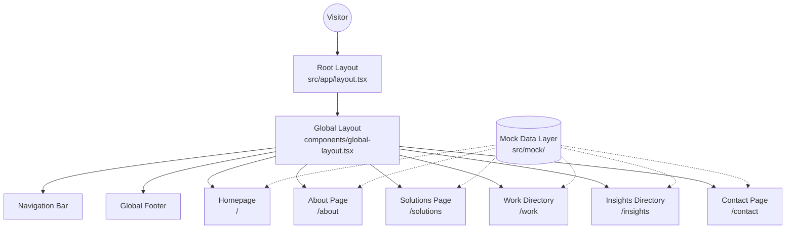

# Project Map (Visual Architecture)

### Data Flow Explanation
1. **User Request:** A user visits a URL (e.g., `/insights`).
2. **Layout Wrap:** Next.js renders `RootLayout` (applying fonts and global CSS), then mounts `GlobalLayout` (which adds the Navigation and Footer).
3. **Page Render:** The specific page component (e.g., `InsightsPage`) is rendered in the main content slot.
4. **Data Hydration:** The page imports static arrays from `src/mock/` to populate UI components like cards, tags, and text content.
5. **Interactive Client Logic:** Forms and search filters (like on the Insights or Contact pages) execute purely in the browser using React state, providing immediate feedback.
